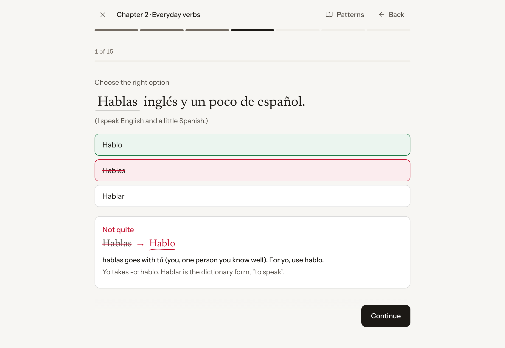

# Stilus

A web app for language learning designed to be more intensive than popular alternatives (looking at you Duo). Fun but not easy. Built around active practice and focused on romance languages. Invite-only.



## What this is
I have spent years telling myself I'll learn a romance language and have never found free or paid apps to be helpful.

Stilus is designed to help me (+ a few friends) learn a romance language, right now limited to:

- Spanish (European)
- French (Standard)
- Latin

Users can select courses, work through chapters and learn from past mistakes.

## Key features
- Tap a word to see its meaning and save it to My words.
- Spaced-repetition review. Saved words come back when you are about to forget them.
- Weak-spot drills, so practice goes where it is needed most.
- A daily plan with an active-time tracker.
- AI correction and role-play chat. The tutor explains the mistake and plays a character in short scenes.
- Fair marking. Small spelling slips earn half marks rather than zero.
- Familiar chapter and content shape every time.

## Product decisions
- Active practice over volume. Variety and doing beat long passive sessions, so every chapter mixes formats.
- Free plans only. Cloudflare Workers, D1 and Access, plus the Gemini free tier. The cost of running Stilus is zero, and that shaped everything below.
- A capped tutor. The AI tutor allows 60 calls per person and 450 in total per day. The caps keep the app inside the free tier, and the remaining calls are shown to the learner so the limit is never a surprise.
- European Spanish content prioritised.
- Beginner-safe explanations. No grammar term is used before a chapter has taught it.
- Calm interface. The look is an exercise book on a café table. Red-pen marks appear only for corrections.

## How this was built
Designs were made in Claude Design, given an initial clean-up with [unslop](https://github.com/heydamir/unslop) by Damir Sokolovsky (CC BY 4.0), then tweaked further in Figma.

The code is written with an AI pair-programmer (Claude Code). `CLAUDE.md` is the technical reference it works from, and `HANDOVER.md` lists the open steps.

The lesson content (Spanish, French and Latin) is also AI-written, so treat it as a study aid rather than an authority. It can contain mistakes. Latin is checked against Whitaker's Words and Wheelock's Latin where possible.

## Tech stack
- [Cloudflare Workers](https://workers.cloudflare.com/) for the app and API
- [Cloudflare D1](https://developers.cloudflare.com/d1/) (SQLite) for synced progress
- [Cloudflare Access](https://developers.cloudflare.com/cloudflare-one/policies/access/) for sign-in, with an email allow-list
- Google Gemini 3.5 Flash-Lite (free tier) for the tutor
- Plain HTML, CSS and JavaScript on the front end

## Project structure
```
public/              the front end: app.js (screens and exercises), logic.js (marking, review, sync rules), sw.js (offline)
public/courses/      course content, one folder per course (chapters, words of the day, glossary)
server.js            local server: serves public/ and the AI tutor, no install needed
lib/ai.js            the AI tutor (prompts, model call, output checks), shared by the local server and the Worker
worker/index.js      the hosted Worker: sign-in check, AI caps, progress sync, profiles
wrangler.jsonc       Worker configuration
migrations/          D1 database schema
tools/               content checker
tests/               unit tests and the browser test
CLAUDE.md            full technical reference
HANDOVER.md          open steps
START-HERE.txt       step-by-step setup on Windows
```

## Getting started
You need [Node.js](https://nodejs.org) (the LTS version). The AI tutor also needs a free Gemini key, which needs a Google account.

```
git clone https://github.com/karatravadi/Language-Learner.git
cd Language-Learner
npm start
```

Then open http://localhost:3000. On Windows you can double-click `start.bat` instead, and
[START-HERE.txt](START-HERE.txt) walks through it step by step. Locally, progress is saved in your browser.

Every chapter, review and the word of the day work without a key. To switch on the AI tutor (sentence checking and
chat), copy `settings.example.env` to `settings.env` and add your own free Gemini key from
[Google AI Studio](https://aistudio.google.com/), then restart.

### The hosted version (sign-in and sync)
This needs a free Cloudflare account. `npm install` once, then `npm run dev:hosted` runs it on your machine with a
local database (add a `.dev.vars` file with `DEV_USER=you@example.com` as a test login). To deploy your own copy,
create a D1 database and an Access application, put their IDs in `wrangler.jsonc` (`ACCESS_AUD` is the ID of my
Access application, so replace it), add the key with `npx wrangler secret put GEMINI_API_KEY`, then `npm run deploy`.

## Tests
```
npm test        unit tests (marking, spaced repetition, sync rules, every chapter's answers) and the content checker
npm run e2e     plays every chapter of every course in headless Chrome, with and without the AI tutor,
                at desktop and at 360, 390 and 430px phone widths, including offline (needs npm install once)
```

The content checker rejects things like answers missing from their options, word tiles that don't build the
sentence, words with no glossary entry, and labels that rely on colour alone. The tests use a mock AI, so they don't
cover the hosted Worker or the live model.

## What's not done yet
- Automated tests for the hosted Worker.
- Clearer explanations for absolute beginners, for example ustedes as the formal plural.

Next on the course roadmap:
- Spanish: irregular favourites, what happened (past tense), describing people and places, then an A2 checkpoint/test.
- French: chapters 9 to 12, then an A2 checkpoint/test.
- Latin: describing words, was and will be, the third declension, then real texts.

## Licence
MIT for the code, see [LICENSE](LICENSE). Lesson content is AI-written and shared as is.
